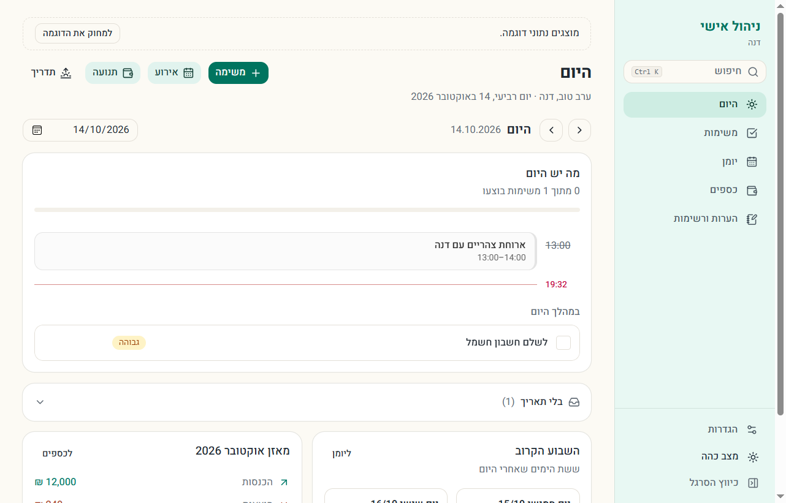

# ניהול אישי — personal management

A Windows desktop app for running your day — tasks, calendar, money, notes and
lists — in Hebrew. Everything stays on your computer: no account, no server, no
tracking.

[עברית](README.md)

## Install

1. Download `…_x64-setup.exe` from the [latest release](../../releases/latest).
2. Run it. It installs for your user only — no administrator rights needed.
3. On first launch, enter your name and choose to start empty or with sample data.

Windows SmartScreen may warn that the publisher is unknown: the installer is not
signed with a paid certificate yet. Choose **More info → Run anyway**. The
installer is built from this source by GitHub Actions.

Requires Windows 10 or 11 (64‑bit). WebView2 ships with Windows; the installer
downloads it if it is missing.

## Your data

Stored in `%APPDATA%\io.github.mydevtools-lm.management\`: the SQLite database,
the last 14 daily backups, and your Google Calendar addresses and Claude API key,
encrypted with Windows DPAPI. Uninstalling keeps your data unless you tick
the box to delete it.

The interface is Hebrew only in version 1.

## Development

Built with Tauri 2, Next.js 16, TypeScript and SQLite. See
[docs/DEVELOPMENT.md](docs/DEVELOPMENT.md) (in Hebrew) and
[CONTRIBUTING.md](CONTRIBUTING.md). Licensed under [MIT](LICENSE).
Security issues: [SECURITY.md](SECURITY.md).
