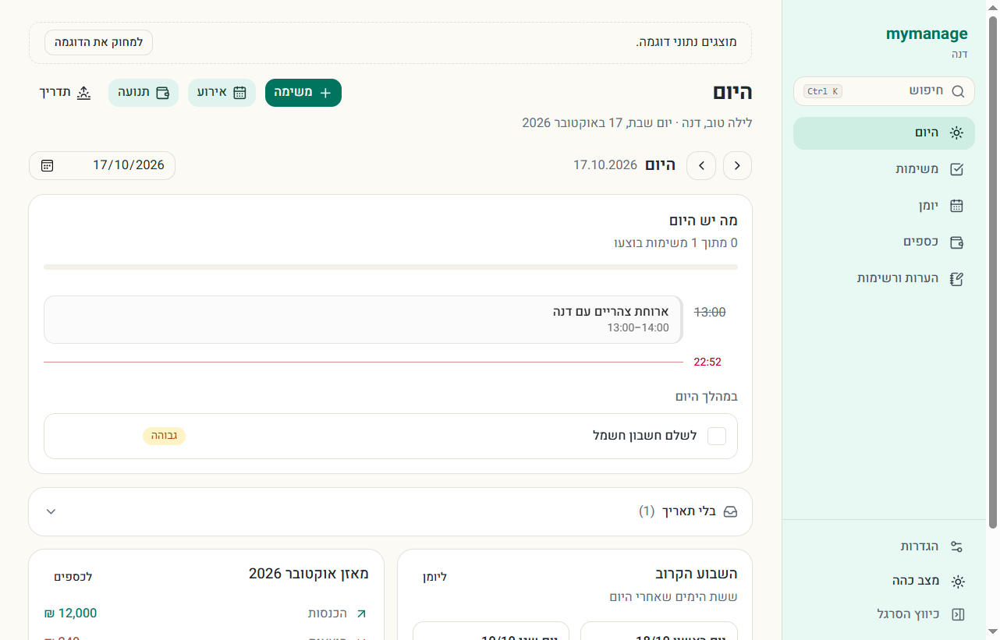
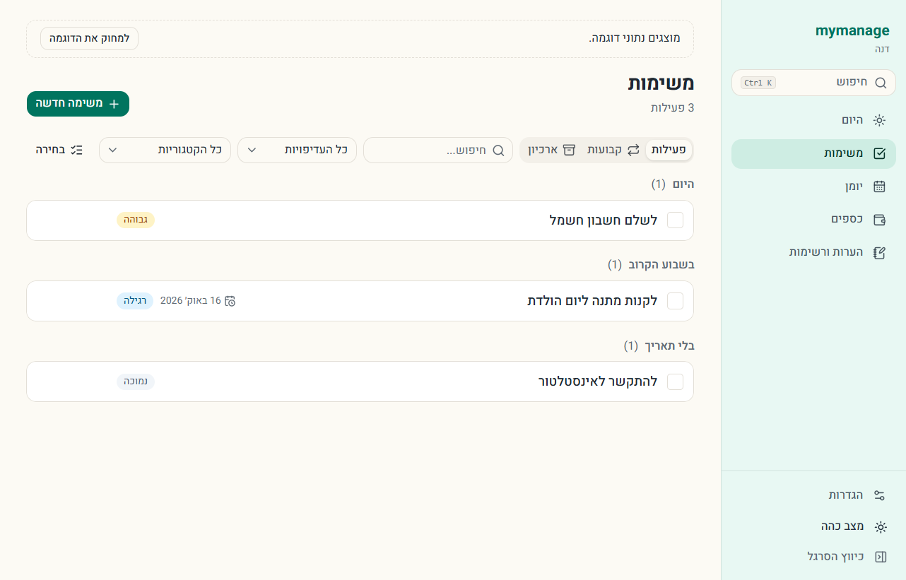
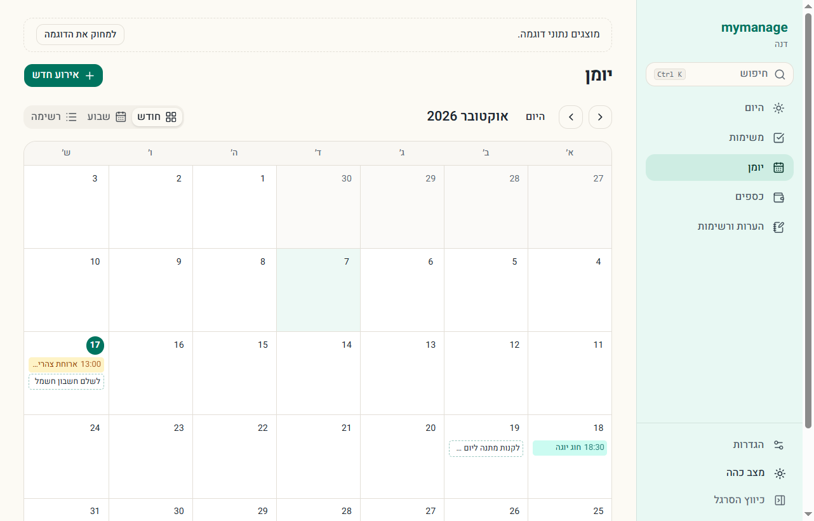
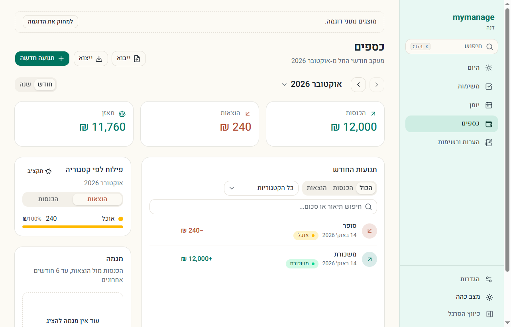
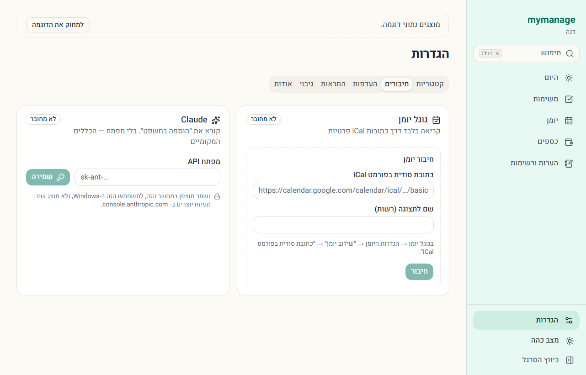

<div dir="rtl">

# mymanage

אפליקציה למחשב לניהול היום: משימות, יומן, כספים, הערות ורשימות — במקום אחד,
בעברית או באנגלית. הכול נשמר אצלך במחשב. אין חשבון, אין שרת ואין מעקב.

[English](README.md)



## מה יש בה

| מסך               | מה עושים בו                                                                                                 |
| ----------------- | ----------------------------------------------------------------------------------------------------------- |
| **היום**          | ציר היום — אירועים ומשימות לפי שעה, מה שנגרר מאתמול, השבוע הקרוב ומאזן החודש. תדריך בוקר                    |
| **משימות**        | לפי זמן, תת‑משימות, משימות קבועות, תזכורות, ארכיון; גרירת משימה ליום אחר                                    |
| **יומן**          | חודש, שבוע ורשימה. אירועים חוזרים, גרירה, ועד 9 יומני גוגל (קריאה בלבד), וחגי ישראל וימי זיכרון (2026–2028) |
| **כספים**         | חודש ושנה, תנועות חוזרות, תקציבים, ייבוא דף חשבון, ייצוא ל‑CSV ולדוח                                        |
| **הערות ורשימות** | רשימות לשימוש חוזר, הערות עם צבע ונעיצה                                                                     |

ובכל מסך: `Ctrl+K` לחיפוש בכל המערכת ול״הוספה במשפט״ — כותבים ״מחר ב‑10 פגישה
עם רואה חשבון״ ומקבלים אירוע מוכן. `?` מציג את קיצורי המקלדת.

|                                           |                                             |
| ----------------------------------------- | ------------------------------------------- |
|   |    |
|  |  |

## התקנה

1. מורידים את קובץ ההתקנה (`…_x64-setup.exe`) מ‑[עמוד הגרסאות](../../releases/latest).
2. מפעילים אותו. ההתקנה היא למשתמש שלך בלבד, ולא צריך הרשאות מנהל.
3. בפתיחה הראשונה בוחרים שפה (השפה של Windows כבר מסומנת), אומרים איך לקרוא לך,
   ובוחרים להתחיל ריק או עם נתוני דוגמה (נמחקים בלחיצה אחת).

**Windows מזהיר ש״Windows הגן על המחשב שלך״?** המתקין עוד לא חתום בתעודה בתשלום,
ולכן SmartScreen לא מכיר אותו. לוחצים **מידע נוסף** ואז **הפעל בכל זאת**. הקוד כולו
כאן, והמתקין נבנה ממנו אוטומטית ב‑GitHub Actions.

דרישות: Windows 10 או 11 (64 ביט). WebView2 כבר מותקן ב‑Windows; אם חסר, המתקין
מוריד אותו.

## איפה הנתונים

| מה                      | איפה                                                           |
| ----------------------- | -------------------------------------------------------------- |
| המסד                    | `%APPDATA%\io.github.mydevtools-lm.management\data.db`         |
| גיבוי יומי (14 אחרונים) | `backups\` באותה תיקייה, ועוד תיקייה לבחירתך — הגדרות › העדפות |
| גיבוי ידני              | הגדרות › גיבוי — קובץ JSON שאפשר לייבא בחזרה                   |

**כתובות יומן גוגל ומפתח Claude** נשמרים מוצפנים בתיקייה הזו (DPAPI של Windows) —
רק המשתמש שלך במחשב הזה יכול לפענח אותם, והם לא מוצגים שוב במסך.

**עדכונים** — כשיוצאת גרסה, האפליקציה שואלת אם לעדכן עכשיו או ביציאה, ושומרת
גיבוי לפני. הגדרות › אודות מציג את הגרסה.

**הסרה** — מהגדרות Windows › אפליקציות. הנתונים נשארים, אלא אם מסמנים ״למחוק גם
את הנתונים״.

## חיבורים (רשות)

- **גוגל יומן** — הגדרות › חיבורים. מדביקים את ״כתובת סודית בפורמט iCal״ מהגדרות
  היומן בגוגל. קריאה בלבד.
- **Claude** — להוספה במשפט חכמה יותר. מדביקים מפתח API מ‑console.anthropic.com.
  בלי מפתח, הקריאה נעשית בכללים מקומיים (בעברית ובאנגלית).

הרשת משמשת רק לשני אלה. בלי חשבון, בלי טלמטריה.

## שיתוף הנתונים עם Claude (רשות)

`mymanage-mcp.mjs`, שמצורף לכל גרסה, הוא שרת [MCP](https://modelcontextprotocol.io)
קטן. הוא נותן ל‑Claude (Claude Code, Claude Desktop) לענות על ״מה יש לי היום?״ או
״כמה הוצאתי החודש?״ מהנתונים האמיתיים שלך. הוא **רק קורא**: המסד נפתח לקריאה בלבד,
אין בו כלי ששומר או מוחק, והסודות שלך (כתובות היומן ומפתח Claude) אף פעם לא נחשפים.
צריך [Node.js](https://nodejs.org) 22 ומעלה.

1. מורידים את `mymanage-mcp.mjs` מ‑[עמוד הגרסאות](../../releases/latest) ושומרים
   אותו במקום קבוע, למשל `C:Tools`.
2. מוסיפים ל‑Claude Code:
   ```
   claude mcp add mymanage -- node --experimental-sqlite C:Toolsmymanage-mcp.mjs
   ```
   או ל‑`claude_desktop_config.json` של Claude Desktop:
   ```json
   {
     "mcpServers": {
       "mymanage": {
         "command": "node",
         "args": ["--experimental-sqlite", "C:\Tools\mymanage-mcp.mjs"]
       }
     }
   }
   ```

ברירת המחדל היא הנתונים של האפליקציה המותקנת; `--db <נתיב ל‑data.db>` מכוון למסד אחר.
האפליקציה יכולה להישאר פתוחה בזמן ש‑Claude קורא.

## קוד פתוח

רישיון [MIT](LICENSE). להרצה מהקוד ולתרומה — [docs/DEVELOPMENT.md](docs/DEVELOPMENT.md)
ו‑[CONTRIBUTING.md](CONTRIBUTING.md) (באנגלית). בעיית אבטחה — [SECURITY.md](SECURITY.md).
מה השתנה בכל גרסה — [CHANGELOG.md](CHANGELOG.md).

</div>
